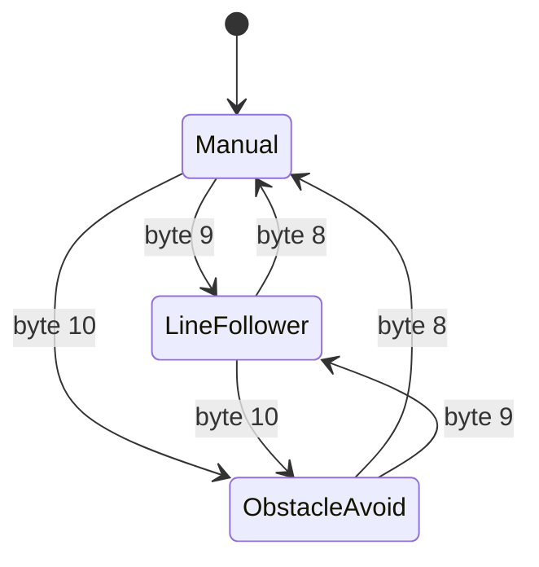
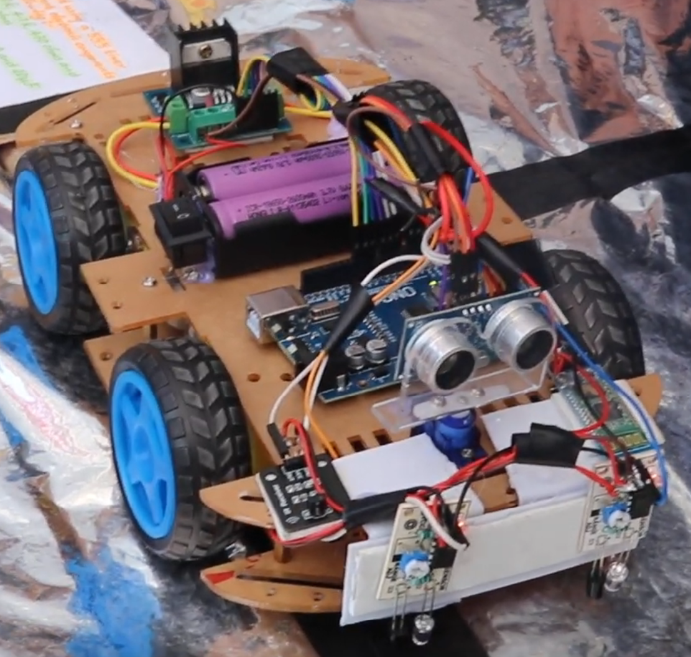
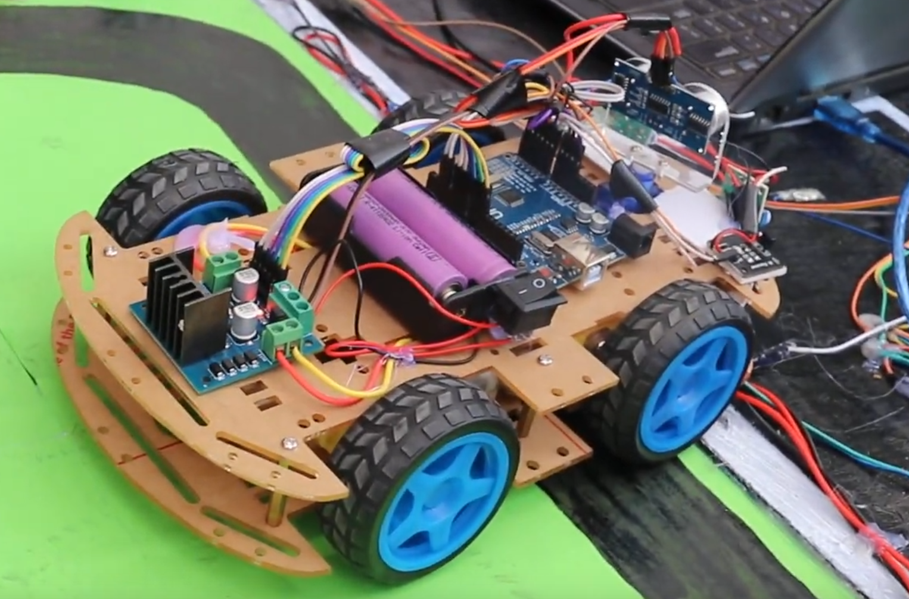

# 🤖 ALL_IN_ONE_ARDUINO_ROBOT

_A Line Follower + Obstacle Avoiding Robot Car Controlled by IR Remote & Mobile App_

<div>


</div>

---

## 📌 Introduction

Welcome to the **Arduino All-in-One Robot** project!  
This multipurpose robot combines **line following**, **obstacle avoidance**, and **remote/mobile control** into a single platform. It can be operated using:

- 🎛️ **IR Remote** (MP3 remote with custom button mapping)
- 📱 **Android App** (built with MIT App Inventor, includes Bluetooth & voice control)

This project is perfect for **students, hobbyists, and robotics enthusiasts** who want to explore autonomous navigation and interactive control systems.

---

## ⚙️ Features

- ✅ **Line Follower Mode** – Follows black/white paths using IR sensors
- ✅ **Obstacle Avoidance Mode** – Detects and avoids obstacles with ultrasonic sensor
- ✅ **Manual Control** – Operated via IR remote or Android app
- ✅ **Voice Commands** – Control robot with speech recognition
- ✅ **Speed Control** – Adjustable via mobile app slider
- ✅ **DIY Friendly** – Easy to assemble with common Arduino components

---

## 🧩 Components Required

| Component                          | Quantity  |
| ---------------------------------- | --------- |
| 5mm Acrylic Sheet (20cm x 12cm)    | 1         |
| DC Gear Motor                      | 4         |
| Arduino UNO                        | 1         |
| IR Sensor                          | 2         |
| L298 Motor Driver                  | 1         |
| HC-05 Bluetooth Module             | 1         |
| IR Receiver Module                 | 1         |
| MP3 Player IR Remote               | 1         |
| SG90 Servo Motor                   | 1         |
| Ultrasonic Sensor HC-SR04 + Holder | 1         |
| Robot Car Wheels                   | 4         |
| Jumper Wires (M-F)                 | As needed |
| On/Off Switch                      | 1         |
| 18650 Battery Holder (2-cell)      | 1         |
| 18650 Li-ion Battery (3.7V)        | 2         |

---

## 🔌 Circuit Overview

- **Power Supply:** 2 × 18650 batteries in series (7.4V)
- **Microcontroller:** Arduino UNO
- **Motor Driver:** L298N for left & right motors
- **Sensors:**
  - IR sensors → Line following
  - Ultrasonic sensor → Distance measurement
- **Control Modules:**
  - HC-05 Bluetooth → Mobile app control
  - IR Receiver → Remote control
- **Servo Motor:** Rotates ultrasonic sensor for scanning

---

## 🎮 Control Mapping

### IR Remote

- `▲` → Move Forward
- `▼` → Move Backward
- `▶` → Turn Right
- `◀` → Turn Left
- `1` → Manual Mode
- `2` → Line Follower Mode
- `3` → Obstacle Avoidance Mode

### Mobile App (MIT App Inventor)

- **Buttons:** Forward, Backward, Left, Right, Stop
- **Voice Commands:** “Go Forward”, “Stop”, “Go Back”, “Turn Right”, “Turn Left”
- **Modes:** Line Following, Obstacle Avoidance, Manual
- **Slider:** Adjust robot speed

---

## 🎮 Command Mapping Table

| App Control (MIT Block)             | Data Sent (1‑Byte Number) | Arduino Code Interprets As | Robot Action                 |
| ----------------------------------- | ------------------------- | -------------------------- | ---------------------------- |
| **Forward (TouchDown)**             | `1`                       | `bt_ir_data == 1`          | Move Forward                 |
| **Backward (TouchDown)**            | `2`                       | `bt_ir_data == 2`          | Move Backward                |
| **Left (TouchDown)**                | `3`                       | `bt_ir_data == 3`          | Turn Left                    |
| **Right (TouchDown)**               | `4`                       | `bt_ir_data == 4`          | Turn Right                   |
| **Stop (manual mode only) / Button Release (TouchUp)** | `0`                       | `bt_ir_data == 0` → Stop (manual mode only)   | Stop (manual mode only) Motors                  |
| **Stop (manual mode only) Button (optional)**          | `5`                       | `bt_ir_data == 5`          | Stop (manual mode only) Motors                  |
| **Voice Left**                      | `6`                       | `bt_ir_data == 6`          | Short Left Turn (momentary)  |
| **Voice Right**                     | `7`                       | `bt_ir_data == 7`          | Short Right Turn (momentary) |
| **Manual Mode**                     | `8`                       | `mode = 0`                 | Switch to Manual Control     |
| **Line Follower Mode**              | `9`                       | `mode = 1`                 | Enable Line Following        |
| **Obstacle Avoid Mode**             | `10`                      | `mode = 2`                 | Enable Obstacle Avoidance    |
| **Slider (Speed Control)**          | `21–255`                  | `Speed = data`             | Adjust Motor Speed (PWM)     |

---

## 📱 Mobile App Setup

- Install the provided **APK** on your Android device
- Or import the **AIA** file into [MIT App Inventor](https://appinventor.mit.edu/) to customize
- Connect via **Bluetooth (HC-05)** → Default pairing code usually `1234` or `0000`

---

## 🛠️ Arduino Setup

1. Install [Arduino IDE](https://www.arduino.cc/en/software)
2. Install **IRremote** (the sketch uses its v3-style `IrReceiver` API) and **Servo**; `SoftwareSerial` is supplied by the Arduino AVR core
3. Select **Arduino UNO** board & correct COM port
4. Upload the provided `.ino` code
5. Power the robot and test each mode

---

## Pinout and firmware states

The table follows [AIOR.ino](AIOR.ino); confirm the physical wiring against [schematic.png](schematic.png) before connecting power.

| Connection | Arduino Uno pin |
| --- | --- |
| HC-05 TX → Uno software RX | D2 |
| Uno software TX → HC-05 RX | D3 (use a suitable logic-level divider) |
| L298N right enable / IN1 / IN2 | D10 / D9 / D8 |
| L298N left enable / IN3 / IN4 | D5 / D7 / D6 |
| Right / left line sensor | A0 / A1 |
| HC-SR04 echo / trigger | A2 / A3 |
| Scanning servo signal | A4 |
| IR receiver signal | A5 |

Bluetooth and USB diagnostic serial both use 9600 baud. Motor power must use the driver supply; connect controller, sensor and driver grounds together.

There are three firmware states. Voice turns (`6` and `7`) are actions within manual control.



The IR button labels vary by remote. The firmware maps raw `0xFF30CF` to manual, `0xFF18E7` to line following and `0xFF7A85` to obstacle avoidance. Use the serial output to check your remote's codes; the app's byte table above is the firmware contract.

## Limitations before a moving test

- The servo helper now normalizes the step sign. The descending `140 → 0` startup/scan calls previously increased the angle instead of completing.
- Turns and scanning use blocking delays. Bytes `0`/`5` stop the motors only in manual mode. Autonomous modes ignore those stop bytes; send byte `8` to return to manual and stop once input polling resumes. There is no independent emergency-stop or lost-connection timeout.
- A missing ultrasonic echo returns 400 cm. Obstacle mode treats that as clear space and can drive forward; it cannot distinguish a disconnected sensor from an out-of-range obstacle.
- On a classic ATmega328P Uno, the [Servo library uses Timer1](https://github.com/arduino-libraries/Servo/blob/master/src/avr/ServoTimers.h), which [conflicts with PWM on D9/D10](https://github.com/arduino-libraries/Servo/blob/master/docs/api.md#detach). The right motor enable is D10. This requires a reviewed wiring/timer change before relying on independent motor speed control; this update does not change the pinout.
- Selecting line-following or obstacle mode sets its default speed again while the mode-select command remains the last command. Slider behavior therefore needs a device check in each mode.

For initial checks, lift the wheels clear of the surface and keep motor power easy to disconnect. The host regression check verifies the servo angle sequence only:

```bash
# Python 3 and g++ required; no Arduino board connected.
python3 -m unittest discover -s tests -v
```

Firmware upload, motor polarity, sensor thresholds, IR decoding and timing still require the physical build. The configured scan is `70 → 140 → 0 → 70`, rather than a full 180-degree sweep.

## 🧪 Hardware Testing

- Calibrate IR sensors for black/white surface detection
- Test IR remote buttons for movement & mode switching
- Verify Bluetooth connection with mobile app
- Test voice commands and speed control

---

## 📷 Demo & Media

### Robot Car Build

<p>
  
  
</p>

### 🎥 Full Demo on YouTube

<p>
  <a href="https://youtu.be/u6bmt4iUy5o?si=hHZo-fITO03jiOHA" target="_blank">
    
  </a>
</p>

---

## 📚 Learning Outcomes

- Understanding of **autonomous navigation**
- Integration of **sensors, actuators, and wireless modules**
- Hands-on experience with **Arduino programming**
- Exposure to **MIT App Inventor mobile app development**

---

## ✅ Conclusion

The sketch, App Inventor source, APK, schematic and build photos are included. Use the pinout and limitations above when adapting the build; the photos and demo are separate from the host regression check.

---

## 📜 License

This project is licensed under the **Apache License 2.0** – see the [LICENSE](LICENSE) file for details.
